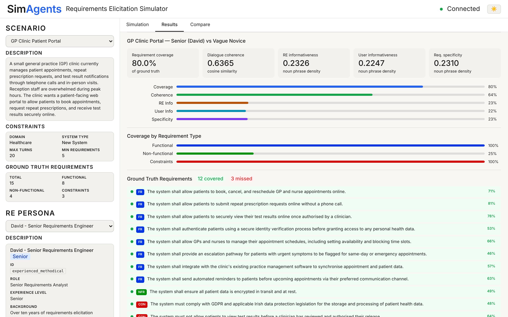
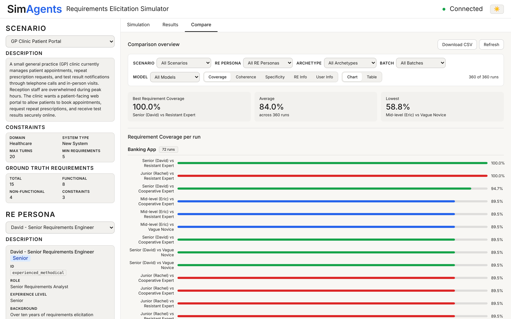
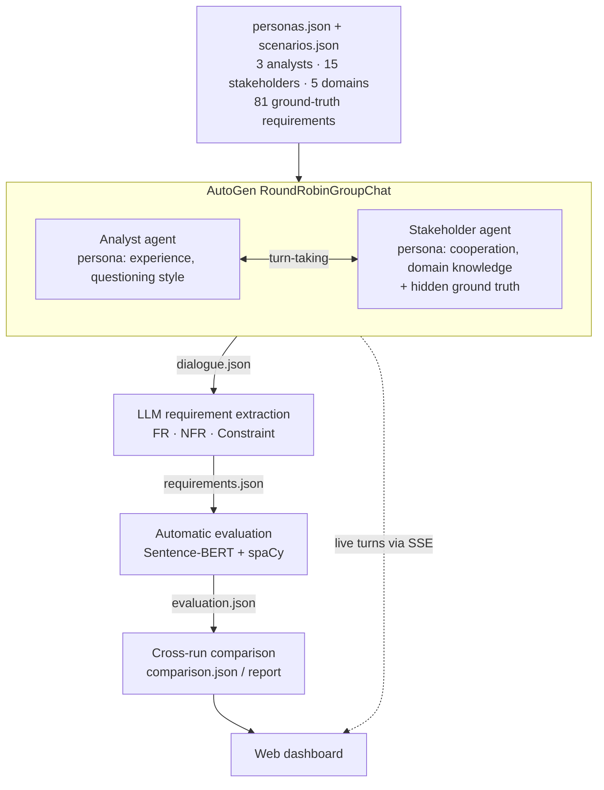
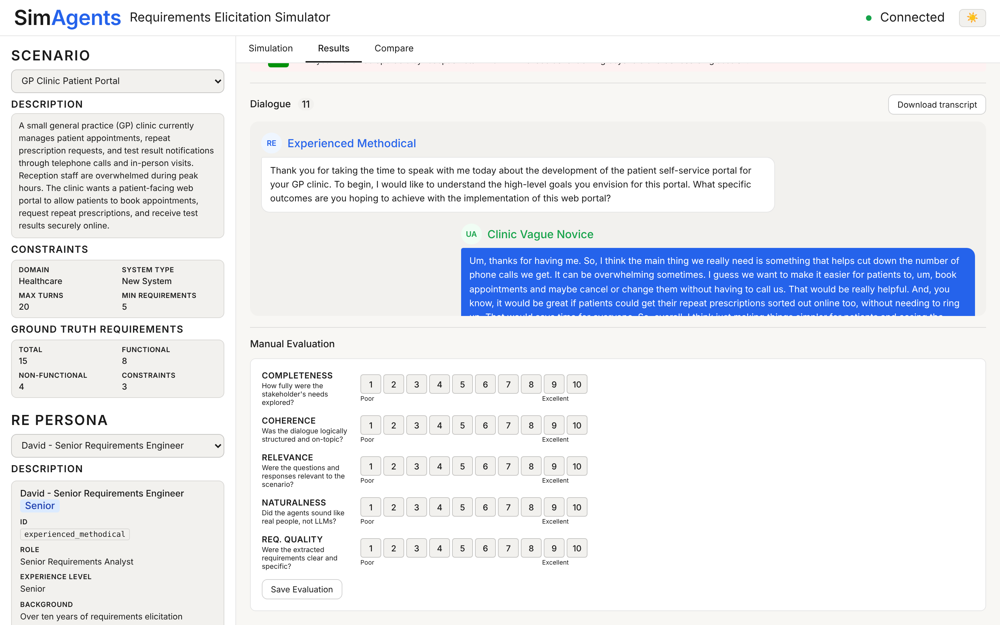

# SimAgents

**A multi-agent LLM framework that simulates requirements-elicitation interviews and scores them automatically.**

Two LLM agents (a requirements analyst and a business stakeholder) hold a structured interview. The requirements are then extracted from the transcript and scored against a ground-truth set. This makes it possible to measure how analyst experience and stakeholder behaviour affect the quality of what gets elicited, across hundreds of repeatable runs.


> Final Year Project, BSc Computer Systems (LM121), University of Limerick, 2026



---

## Highlights

- **Multi-agent orchestration.** An analyst agent and a stakeholder agent take turns in an AutoGen `RoundRobinGroupChat`. The interview ends when the analyst emits `REQUIREMENTS_COMPLETE` or the turn budget runs out.
- **Persona-conditioned agents.** There are 3 analyst personas (Senior, Mid-level, Junior) and 15 stakeholder personas, which cover 3 behavioural archetypes in each of 5 domains. Every stakeholder privately holds the scenario's full ground truth, and only the archetype changes *how* it gets disclosed. This keeps the experiment controlled.
- **LLM requirement extraction.** Transcripts are turned into structured JSON, with each requirement classified as Functional, Non-functional or Constraint.
- **Automated evaluation pipeline.** Five metrics per run, computed with Sentence-BERT and spaCy: coverage of ground truth, dialogue coherence, analyst and stakeholder informativeness, and requirement specificity.
- **Batch experiment runner.** Runs the full 45-configuration matrix with resume support, per-configuration error isolation, repeat batches and automatic cross-run aggregation.
- **Real-time web dashboard.** A Flask backend streams each dialogue turn to the browser over Server-Sent Events. The single-file frontend lets you browse, filter, compare and manually rate runs, and export to CSV.
- **Swappable LLM backend.** It runs on the OpenAI API (GPT-4o-mini) or on free local models through Ollama, controlled by one environment variable.

## Results

The full matrix (5 scenarios × 3 analyst personas × 3 stakeholder archetypes = **45 configurations**) was run **8 times**, giving **360 simulated interviews** on GPT-4o-mini. All 360 runs, with their transcripts, extracted requirements and scores, are included in [`outputs/`](outputs/).

**How the stakeholder behaves affects interview quality much more than how senior the analyst is.**

| Stakeholder archetype | Runs | Requirement coverage | Dialogue coherence |
|---|---:|---:|---:|
| Cooperative Expert | 120 | **86.8%** | **0.705** |
| Resistant Expert | 120 | 82.9% | 0.624 |
| Vague Novice | 120 | 82.2% | 0.606 |

| Analyst persona | Runs | Requirement coverage | Dialogue coherence |
|---|---:|---:|---:|
| Senior (David) | 120 | 83.6% | 0.655 |
| Mid-level (Eric) | 120 | 84.1% | 0.642 |
| Junior (Rachel) | 120 | 84.3% | 0.638 |

- **Stakeholder archetype has a strong effect.** Vague and resistant stakeholders produce noticeably less coherent interviews and lower coverage than cooperative experts. Kruskal–Wallis: p < 0.001 for both metrics.
- **Analyst seniority has almost no measurable effect.** Coverage is within 1 percentage point across Senior, Mid-level and Junior (p = 0.79). The Senior persona's coherence advantage is small and not significant (p = 0.07). Prompting an LLM to act as a more experienced interviewer did not, on its own, produce better elicitation in this setup.
- **Overall, the simulated interviews uncovered 84% of ground-truth requirements on average.** Coverage ranged from 58.8% to 100%, and 29 runs achieved full coverage. Domain matters: the Student Portal scenario was easiest (91.8%), and Banking (80.1%) and Library (80.3%) were hardest.
- **The interviews ended on their own.** In 358 of 360 runs the analyst ended the interview itself, after a mean of 13 messages against a cap of 20. Each run extracted 9.5 requirements on average.



## How it works



1. **Simulate.** The analyst opens the interview in character, and the stakeholder answers according to their persona and the requirements they privately hold. The analyst signals `REQUIREMENTS_COMPLETE` once it has gathered enough clear requirements (5 per scenario), or the session stops at 20 messages.
2. **Extract.** A separate LLM call reads the transcript and returns typed requirements as JSON.
3. **Evaluate.** Five metrics are computed for each run (see [Evaluation metrics](#evaluation-metrics)).
4. **Compare.** Results are aggregated across runs into `comparison.json` and a readable `comparison_report.txt`.



## Quick start

Requires **Python 3.11**.

```bash
git clone https://github.com/Tommybyrne23/SimAgents.git
cd SimAgents

python -m venv .venv
# Windows:  .venv\Scripts\activate
# macOS/Linux:  source .venv/bin/activate

pip install -r requirements.txt
python -m spacy download en_core_web_sm
```

### Explore the results (no API key needed)

```bash
python server.py
```

Open http://localhost:5000. The **Results** and **Compare** tabs load all 360 recorded runs from `outputs/`.

### Run your own simulations

Copy the example environment file and add your key:

```bash
cp .env.example .env        # Windows: copy .env.example .env
```

| Variable | Purpose | Default |
|---|---|---|
| `USE_LOCAL` | `false` = OpenAI API, `true` = local Ollama model | `false` |
| `OPENAI_API_KEY` | Required when `USE_LOCAL=false` | none |
| `OPENAI_MODEL` | OpenAI model name | `gpt-4o-mini` |
| `LOCAL_MODEL` | Ollama model name | `llama3.2` |
| `TEMPERATURE` | Response randomness (0.0–1.0) | `0.7` |
| `SEED` | Optional fixed seed for reproducible runs | blank |

To use free local models instead, install [Ollama](https://ollama.com), run `ollama pull llama3.2`, and set `USE_LOCAL=true`.

Then use any of these:

```bash
# Web dashboard: pick a scenario and personas, then watch the interview stream live
python server.py

# Single run from the command line (edit the index constants at the top of main.py)
python main.py

# Full 45-configuration experiment
python batch_runner.py                 # run everything not yet completed (resumable)
python batch_runner.py --batch 2       # a repeat batch (run IDs get a _batch2 suffix)
python batch_runner.py --scenarios 0,1 --re-personas 0 --archetypes 1,2   # a subset
python batch_runner.py --dry-run       # list configurations without running
python batch_runner.py --force         # re-run everything
python batch_runner.py --no-eval       # dialogue + extraction only
python batch_runner.py --no-compare    # skip the final aggregation step

# Re-score or re-aggregate existing runs
python src/evaluation.py outputs/<run_id>/
python src/comparison.py outputs/
```

## Evaluation metrics

| Metric | What it measures | Method |
|---|---|---|
| **Requirement coverage** | Share of ground-truth requirements that came up in the interview | For each ground-truth requirement, the maximum Sentence-BERT cosine similarity to any dialogue turn. Counted as covered at ≥ 0.4. Also broken down by FR / NFR / Constraint. |
| **Dialogue coherence** | Whether consecutive turns respond to each other | Mean Sentence-BERT (`all-MiniLM-L6-v2`) cosine similarity between consecutive turns |
| **Analyst informativeness** | Information density of the analyst's turns | Mean noun-phrase density (noun chunks ÷ tokens) via spaCy `en_core_web_sm` |
| **Stakeholder informativeness** | Information density of the stakeholder's turns | Same as above, applied to stakeholder turns |
| **Requirement specificity** | How concrete the extracted requirements are | Mean noun-phrase density of the extracted requirement statements |

The dashboard also supports **manual evaluation**. A reviewer can rate each run from 1 to 10 on completeness, coherence, relevance, naturalness and requirement quality, and the ratings are saved alongside the automatic scores.

## Scenarios and personas

| Scenario | Domain | Ground truth (FR / NFR / CON) | Cooperative Expert | Vague Novice | Resistant Expert |
|---|---|---|---|---|---|
| Barbershop Booking System | Appointment scheduling (new) | 14 (9 / 3 / 2) | Kyle, owner | Evan, new manager | Katie, senior receptionist |
| GP Clinic Patient Portal | Healthcare (new) | 15 (8 / 4 / 3) | Dr. Brennan, practice manager | Liam, practice administrator | Nuala, head receptionist |
| University Library Management System | Academic services (existing) | 17 (9 / 4 / 4) | Oisin, head librarian | Cian, first-year student rep | Brendan, senior library assistant |
| University Student Portal Enhancement | Academic services (existing) | 16 (8 / 4 / 4) | Ludwig, academic quality manager | Aoife, second-year undergraduate | Declan, senior IT sysadmin |
| Legacy Bank Mobile App Modernisation | Financial services (existing) | 19 (9 / 5 / 5) | Bart, head of digital banking | Luke, retail customer | Ruari, chief risk & compliance officer |

**Analyst personas:** **David** (Senior: structured, deep probing, summarises often), **Eric** (Mid-level: adaptive questioning) and **Rachel** (Junior: surface-level questioning).

Every persona is defined in [`config/personas.json`](config/personas.json). Each one has a background, tone, cooperation level, domain knowledge and behavioural flags, plus a short rationale grounded in the requirements-engineering literature. Scenarios and their ground-truth requirements are in [`config/scenarios.json`](config/scenarios.json).

## Project structure

```
SimAgents/
├── config/
│   ├── personas.json        # 3 analyst + 15 stakeholder persona definitions
│   └── scenarios.json       # 5 scenarios with ground-truth requirements
├── src/
│   ├── agents.py            # Model client + analyst/stakeholder agent factories
│   ├── session.py           # RoundRobinGroupChat orchestration and termination
│   ├── extraction.py        # LLM-based requirement extraction
│   ├── evaluation.py        # Five-metric automatic evaluation
│   └── comparison.py        # Cross-run aggregation and report
├── ui/
│   └── index.html           # Dashboard (single-file SPA, light/dark mode)
├── outputs/                 # 360 recorded runs + comparison.json / comparison_report.txt
├── docs/screenshots/
├── server.py                # Flask API + SSE streaming
├── main.py                  # Single-run CLI
├── batch_runner.py          # 45-configuration batch runner
├── requirements.txt
└── .env.example
```

Each run directory contains `dialogue.json` (the transcript), `requirements.json` (the extracted requirements) and `evaluation.json` (the metric scores).

## Tech stack

| Component | Technology |
|---|---|
| Multi-agent framework | Microsoft AutoGen AgentChat 0.7 (`RoundRobinGroupChat`, `AssistantAgent`) |
| LLM | OpenAI GPT-4o-mini; Ollama (e.g. Llama 3.2) for local development |
| Semantic similarity | Sentence-BERT `all-MiniLM-L6-v2` |
| NLP | spaCy `en_core_web_sm` |
| Backend | Python, Flask, Server-Sent Events |
| Frontend | HTML, CSS and vanilla JavaScript (no build step) |

## Limitations

- **Coverage checks whether a requirement came up, not whether it was captured correctly.** It uses semantic similarity at a 0.4 threshold against the dialogue turns.
- **The informativeness and specificity scores are proxies.** Noun-phrase density measures how dense the language is, not how good the requirements are. The dashboard's manual ratings add a human check alongside them.
- **All 360 experiment runs use a single model (GPT-4o-mini).** Other LLMs may behave differently.
- **The analyst stops once it has 5 clear requirements**, so most interviews are short (about 13 messages). A larger budget may separate the analyst personas more clearly.

## Author

**Thomas Byrne**, BSc Computer Systems, University of Limerick. [GitHub](https://github.com/Tommybyrne23)

Licensed under the [MIT License](LICENSE).

## References

- [AutoGen documentation](https://microsoft.github.io/autogen/stable/)
- [OpenAI GPT-4o-mini](https://developers.openai.com/api/docs/models/gpt-4o-mini)
- [Ollama API](https://docs.ollama.com/api/introduction)
- [Sentence-BERT all-MiniLM-L6-v2](https://huggingface.co/sentence-transformers/all-MiniLM-L6-v2)
- [spaCy en_core_web_sm](https://huggingface.co/spacy/en_core_web_sm)
